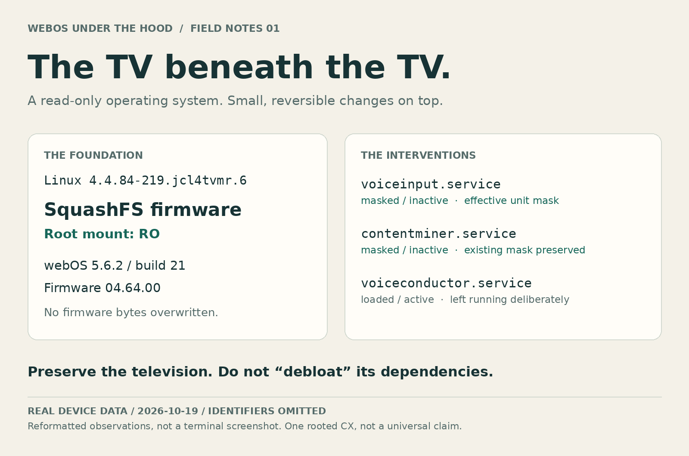

# webOS Under the Hood

[](https://github.com/Resnais-Beefhair/webos-under-the-hood/actions/workflows/offline.yml)

**A reversible privacy field guide for a rooted LG CX, with real evidence from inside the TV.**



A smart TV is also a Linux computer. This project documents how one already-rooted LG OLED65CX6LA was inspected, given a safer management connection, and configured to reduce selected collection and recommendation features without dismantling its normal TV functions.

It contains the **code, exact settings, connection instructions, checkpoints, recovery procedures and honest limits**. You can follow it yourself or give the repository to an agent. You do not need an AI account, Hermes, cloud inference or any paid service.

> **Not a universal debloater or rooting exploit.** Tested source device: **OLED65CX6LA · firmware 04.64.00 · webOS 5.6.2-21**, inspected on 19 October 2026. Other models and firmware are not validated. A valid SSH session and schema/hash matches are prerequisites, not proof that every feature is safe on another TV.

## Start here

1. Read [compatibility, risks and scope](docs/compatibility.md). Root and Homebrew Channel already existed on the source TV; do not begin by upgrading, factory-resetting or trying random exploits.
2. Follow [connection and recovery setup](docs/connection.md). Verify a **new key-authenticated, host-key-pinned SSH session before closing ordinary telnet**.
3. Run the read-only audit, then choose individual changes in the [human walkthrough](docs/walkthrough.md). Planning does not apply changes.
4. Keep your private checkpoints. Use the [verification and rollback guide](docs/recovery.md) after every feature and after a later, deliberately scheduled cold start.

```sh
git clone https://github.com/Resnais-Beefhair/webos-under-the-hood.git
cd webos-under-the-hood
python3 tvctl.py --help
python3 -m unittest discover -s tests -v
python3 tvctl.py --target lg-tv audit --output .local-state/audit.json
```

`lg-tv` is **your own SSH alias**, not a built-in IP address. No command knows or guesses your TV's address. Linux/macOS and Windows through WSL are the documented host paths. The host CLI uses Python's standard library and OpenSSH; the TV uses its existing tools and Python 2.7. No TV package installation is required by the privacy changes.

Writes require an owner-controlled **exclusive administration window**. Native setters have no atomic compare-and-set; readback checks are not transaction isolation. Automatic checkpoint rollback is deliberately same-boot only. See [recovery](docs/recovery.md) rather than bypassing these limits.

## What you can reproduce

- **Management:** a dedicated SSH key, verified host key and restricted key entry; ordinary Homebrew Channel telnet disabled only after the new connection works. [Connection guide](docs/connection.md)
- **Service masks:** correct an ineffective `/run` mask by overlaying the existing `voiceinput.service` unit with `/dev/null`, and keep `contentminer.service` masked/inactive. Do not delete binaries or disable Home dependencies. [Service-mask guide](docs/services.md)
- **Settings:** native, schema-checked string values for collection/device ID, HbbTV and optionally automatic updates, with per-feature snapshots and readbacks. [Exact change inventory](docs/changes.md)
- **DNS:** an optional change to **only the TV's active Ethernet ConnMan service**, using a chosen resolver such as AdGuard's filtering pair. Explicitly approve the new DNS recipient first. This is not a firewall or LAN isolation. [Walkthrough](docs/walkthrough.md)
- **Diagnostics:** inspect Linux services, mount layers, Luna settings, startup hooks and resolver state. [Under-the-hood gallery](docs/gallery.md)

### Optional: hide YouTube's Home preview cards

**Off unless you deliberately install it.** This is a cosmetic Home customization, not part of the core privacy workflow. The **YouTube icon, app, account and network access are left unchanged**; only the main icon's Home preview row is suppressed. Other apps and YouTube channel shortcuts keep their original path.

The [separate optional module](optional-preview/README.md) generates a tiny producer guard from **your own, exact-hash-matched firmware file**. LG's QML is not redistributed. Read-only overlays and Home-only snapshot bypasses are reversible. A separately approved Home reload window is necessary; no TV reboot or SAM restart is included.

## What this does not claim

- No guarantee of “zero spying”, “all ads removed”, microphone silence or a fully trusted rooted device. An active voice-related process is not proof of recording.
- DNS filtering cannot stop every direct-IP, IPv6 or encrypted-DNS path, and does not isolate devices on the same LAN. It does not reliably remove YouTube in-video ads.
- No blanket disabling of `sdx`, `admanager` or `voiceconductor`; no replacement of binaries with `/dev/null`.
- No consent/EULA mass edits. On this CX the native withdrawal workflow can revoke SDX terms and reboot; it was investigated but **not executed**.
- No router firmware changes, whole-house DNS change, firewall installation, automatic firmware update, exploit execution or factory reset.
- The original changes were read back and selected UI/network checks passed. **Full streaming playback regression and a physical cold boot were not performed.** Public packaging/refactoring tests are distinct from those device observations. [Validation record](docs/validation.md)
- A later read-only post-start check found the masks, DNS and owned preview overlays still present, but **HbbTV read back as `"on"`**. Boot identity had not changed, so that observation does not establish physical cold-boot persistence or the cause of the HbbTV change. No automatic reapply was performed. [Sanitized post-start evidence](assets/evidence/post-start-verification.json)

## Let an agent help

Give the agent the repository and this instruction:

> Read AGENTS.md and the compatibility/connection guides. Start with a read-only audit of the TV I identify. Explain a per-feature plan and rollback. Ask before authentication changes, stopping services, changing DNS recipient, installing hooks or reloading Home. Keep YouTube customization off unless I explicitly choose it. Never upload private diagnostics or reboot the TV without a separate instruction.

[AGENTS.md](AGENTS.md) defines the same boundaries; a repository URL is not blanket permission to change a network.

## Project map

- [What was already installed, what changed, and what did not](docs/changes.md)
- [Manual walkthrough](docs/walkthrough.md) · [Recovery](docs/recovery.md)
- [Real internal views and how they were produced](docs/gallery.md)
- [Architecture and failure modes](docs/internals.md)
- [Evidence, tests and open checks](docs/validation.md)
- [Source references](docs/sources.md) · [Third-party notices](NOTICE.md)
- [Contributing and compatibility reports](CONTRIBUTING.md)

Original project code, documentation and rendered evidence graphics use the [MIT license](LICENSE). LG firmware, Homebrew Channel, OpenSSH/Dropbear, system tools, app assets and third-party trademarks retain their own ownership and licenses; none of their binaries or full firmware source files are bundled. This is an independent project, not an LG or webOSbrew product.
