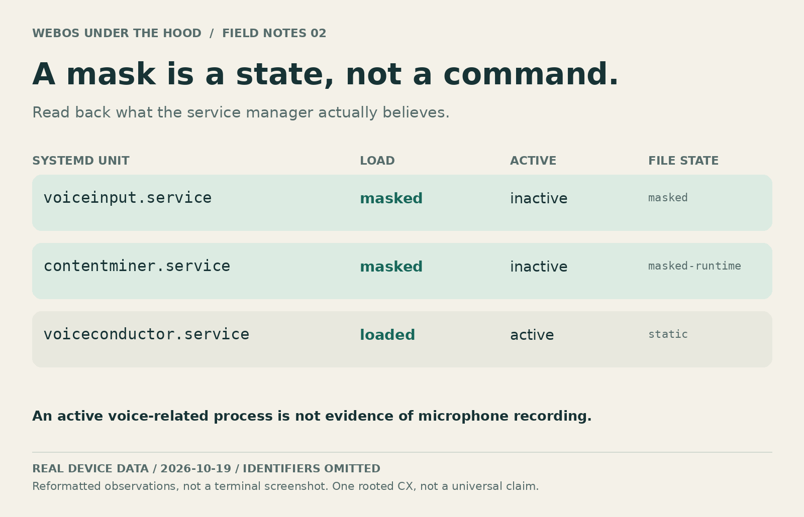
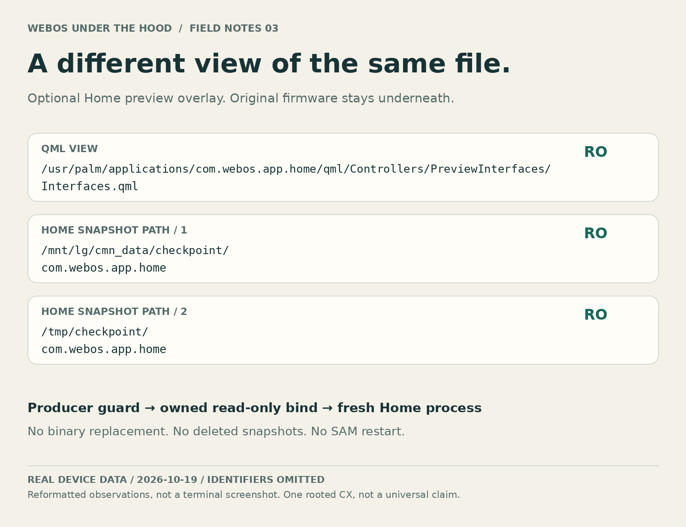

# Under-the-hood gallery

These are **original visualizations of real root-level observations**, not synthetic terminal output or screenshots of a fictional device. The source was one owned, rooted CX. Identifiers were omitted at collection time; the diagrams did not require sending viewing content to an image service.

## The TV is also a Linux machine


The measured root mount was read-only SquashFS. The kernel was `4.4.84-219.jcl4tvmr.6`. Persistent helper files and exact bind overlays sit above the original firmware. The device remained a TV; no general-purpose desktop or background agent was installed.

## What systemd really reports



`voiceinput` and `contentminer` were read back as masked/inactive. `voiceconductor` remained loaded/active by design. That service's name and active state **do not prove microphone recording**. This view matters because an apparently successful runtime-mask command had not overridden the higher-precedence `/etc` voice unit.

## The optional Home layer



The actual mounted QML path and Home-only checkpoint paths were read from `/proc/mounts`. `ro` is the observed mount mode. The original files/snapshots remain underneath; the feature does not delete them. This image describes the optional source installation, **not a feature the core CLI silently enables**.

## Provenance and reproduction

- [cx-internals.json](../assets/evidence/cx-internals.json): a fresh read-only capture made for this public package. It contains OS version/build, three whitelisted service states, five allowed mount targets/modes, telnet flag and one backup-existence boolean. No host/IP/MAC/account/serial/key/process arguments were collected.
- [dns-verification.json](../assets/evidence/dns-verification.json): selected boolean/count fields from the original, completed DNS-change verification. It does not claim the public CLI performed that earlier change.
- [render_gallery.py](../tools/render_gallery.py): the complete original local renderer, reading those public data files. No image model or cloud upload.

You can reproduce a narrow local view with `cat /etc/version`, the selected `systemctl show` fields and an exact-target filter of `/proc/mounts`. Keep your raw output private; do not assume a screenshot is anonymous just because it shows a terminal.

To regenerate the included images, install Pillow **on the host only** in a development environment, provide DejaVu Sans/Mono fonts, and run:

```sh
python3 tools/render_gallery.py
# Or: python3 tools/render_gallery.py --font-directory /path/to/dejavu-fonts
```

Font files and TV firmware are not bundled. Full TV captures were deliberately excluded because recommendation cards and ongoing playback can reveal personal viewing. The GitHub-visible gallery shows machine internals instead.
