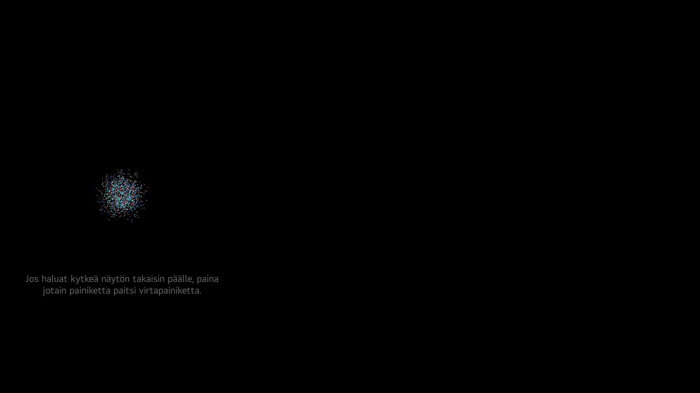
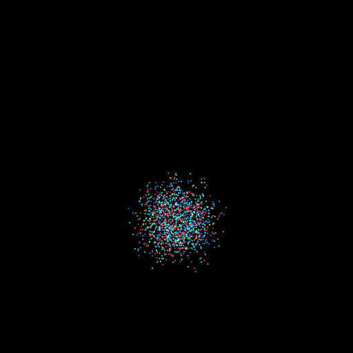
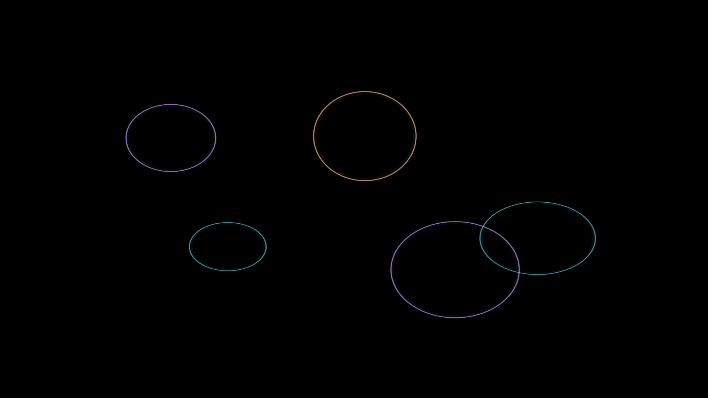

# Screensaver before and after

These are **real, unmodified 1920 × 1080 DISPLAY captures from the same owned LG CX**, not concept renders. The full-frame PNGs retain their native bytes. No brightness, gamma, contrast or color enhancement was applied.

> **Optional and experimental.** The [separate screensaver module](../optional-screensaver/README.md) provides generation, explicit installation, reload, optional persistence and rollback instructions. It is not enabled by cloning this repository, running the privacy CLI or installing the Home-preview option. These captures come from an earlier owner-approved, firmware-pinned experiment, **not a live test of the public generated installer**. This is not a cross-model compatibility promise or a burn-in guarantee.

## Before: native fireworks

The original uses a small moving fireworks area and a localized Finnish wake-up hint. Eight frames were captured at different animation phases; this frame was selected for its clearly visible colorful burst. The hint says to press a button other than power to turn the screen back on.

### Original detail, without artificial brightening

This is a **512 × 512 crop at native pixel size**, not another full-screen layout and not an enlarged or brightened rendering. The exact crop rectangle is recorded in the [public provenance](../assets/evidence/screensavers.json). Use the full frame above for spatial comparison.

## After: moving light rings

The replacement shows slowly drifting colored rings against black, without the wake-up text. The caller's `guideString` interface remains accepted even though it is no longer rendered. Native idle activation, input dismissal, `playing` behavior and the approximately 7.5-second loop contract were left in place; a native application reload was explicitly approved. Other applications and the foreground YouTube process retained their identities during the test.

The earlier experiment passed 15 host Qt/OpenGL behavior/render checks and 9 update-transaction success/error checks; real-TV captures and an independent installed-hash readback were separate checks. Those are not live tests of the public screensaver installer. The public module has its own offline tests. Physical cold-boot persistence and long-term OLED behavior remain unvalidated. The owner's earlier “visible and worked” feedback applied to the preceding starfield, not yet to these rings.

## Reproduce the change yourself

Follow [the complete manual installation and recovery guide](../optional-screensaver/README.md), starting with a pinned SSH connection and a private copy of your own exact firmware files. No AI account, private operator repository or additional TV package is needed. Keep extraction, generation, staging, mounting, reloading and boot persistence separate; do not turn the examples into an unattended paste-all script.

The visual accepts but intentionally does not draw `guideString`. Input handling remains the native application's responsibility; removing a hint is not proof that every physical remote path was tested. Unknown source hashes, foreign hooks or mounts, ambiguous ownership, unsupported native responses and concurrent administration are stop conditions, not reasons to force the change.

## Why the first pictures looked faint

The original capture helper had requested no size and the service returned 960 × 540. This firmware accepted explicit `width: 1920` and `height: 1080`; the response and decoded PNG dimensions both confirmed that size. Selecting a visible burst also matters: the native animation has dim fade phases. Neither observation establishes a universal capture-service dimming bug or measures the panel's actual luminance.

The images show different animation moments, not calibrated brightness or energy comparisons. Their large black areas are intentional. Full-resolution files are available by opening each image directly.

Only the inspected screensaver-only images and [sanitized provenance](../assets/evidence/screensavers.json) were allowlisted. Private backups, TV addresses, credentials, process arguments and LG firmware source remain excluded. LG retains ownership of its native screensaver artwork; the replacement visual code is original project work.
